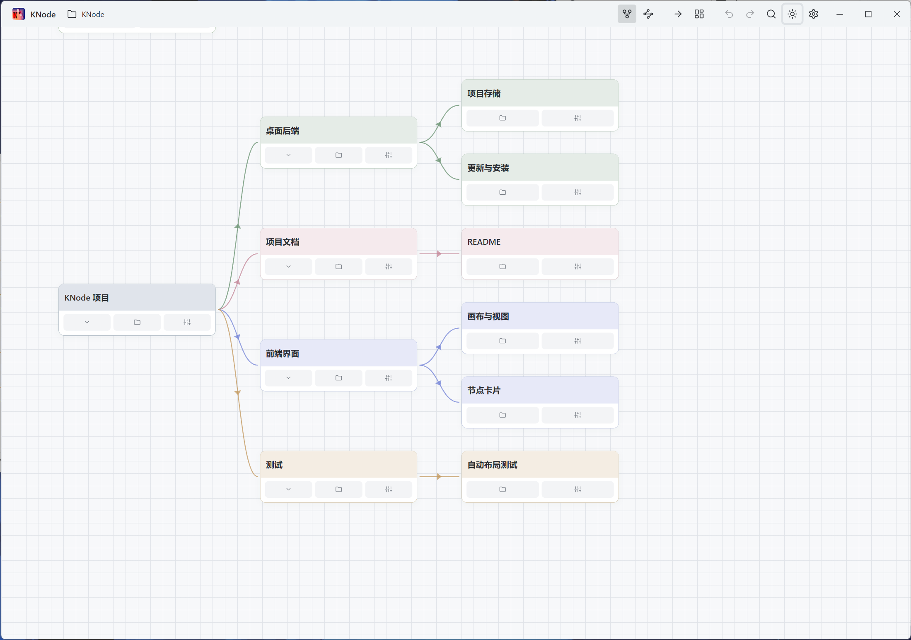
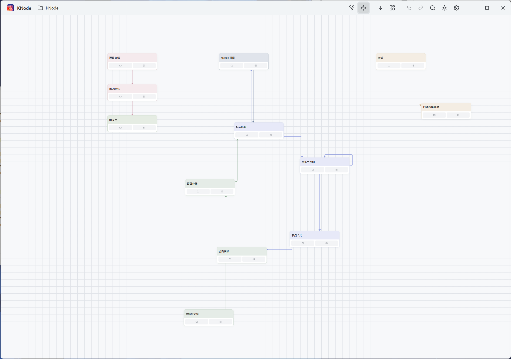

[简体中文](../zh-CN/README.md) | **English**

# KNode

KNode is a local-first Windows app for organizing projects and knowledge. Use Tree View to break a project into tasks and organize your materials, then switch to Graph View to map dependencies, workflows, or connections between ideas. Both views use the same nodes. Internal node files are stored locally with the project, and linked external files stay in their original locations.

## Where the Name Comes From

KNode combines the German word **Knoten** and the English word **Node**. Both can mean “node,” the basic unit KNode uses to organize projects and their materials.

## Key Features

- **Tree View** organizes tasks, modules, and file categories in a hierarchy with collapsible branches. The progress of weighted child nodes rolls up to their parent.
- **Graph View** maps relationships, workflows, and connections between ideas with directed, bidirectional, or undirected edges. It supports self-loops, cycles, and multiple distinct edges between the same pair of nodes.
- **Node file management** stores imported files in the node’s folder within the project. When you link an existing file or folder on your computer, the project records its path and leaves the original in place.
- **TXT and Markdown** files can be created for any node to record descriptions, requirements, and notes.
- **Four-direction auto layout** supports left to right, top to bottom, right to left, and bottom to top. Tree View follows the parent-child hierarchy. In Graph View, standalone chains of at least three nodes with no branches, self-loops, or parallel edges line up in a row or column along the selected direction. Other graphs, including those with cycles, use a two-dimensional layout based on ELK Stress.

## Tree View and Graph View

Both views share node names, colors, progress, and files. Each view stores its own node positions and viewport. You can edit the tree hierarchy and graph connections independently.

### Tree View

Use Tree View to break a project into modules, tasks, and subtasks, or to organize materials in a hierarchy.



### Graph View

Use Graph View to explore dependencies, workflows, and connections across nodes. For example, a single component can connect to several modules.



## Generate a Project with AI

Give an AI assistant the [V3 project format specification](../../DATA_SCHEMA/en/V3.md) and describe the project you want. Ask it to generate a KNode project as plain JSON. Save the result as UTF-8 in `Study Plan/Study Plan.json` and set the JSON `name` to `Study Plan` so it matches both the folder name and the filename before `.json`. In the KNode desktop app, choose **Open project** and select the JSON file.

You can start with the prompt below and replace the project description with your own.

```text
Use the KNode V3 project format specification I provided to generate a project named "Study Plan".
Create nodes and child nodes for reading, practice, and review.
Set format to "forest-project", version to 3, and projectId to a new UUID v4.
Set parentId to null for root nodes. For each child, reference an existing parent and avoid cycles in the tree.
Provide coordinates for every node in tree.positions, spacing the cards apart where possible. Include all required fields for both views.
If graph.edges contains edges, provide coordinates in graph.positions for the source and target of every edge.
If the graph has no edges, graph.positions can be {} and graph.edges can be [].
Do not guess paths on my computer. Omit linkedPaths when there are no external files to link.
Return valid JSON only, with no Markdown fences, comments, or explanations.
```

After the JSON passes validation, KNode places nodes that lack graph coordinates. Every graph edge endpoint needs coordinates in `graph.positions` before validation. You can link files later from a node’s file panel.

## Download and Installation

On Windows x64, download the `-setup.exe` installer from [GitHub Releases](https://github.com/THESuiseiCOMET/KNode/releases) and run it. The desktop app requires Microsoft Edge WebView2, and the installer can download the runtime if needed.

## Tech Stack

- **Desktop** — Tauri 2, Rust, and Windows WebView2
- **Interface and canvas** — Vue 3, TypeScript, Vite, and Vue Flow
- **Auto layout** — Tree View uses a hierarchical layout. Graph View combines simple chain layout with ELK Stress.

## MIT License

KNode is licensed under the [MIT License](../../../LICENSE).
