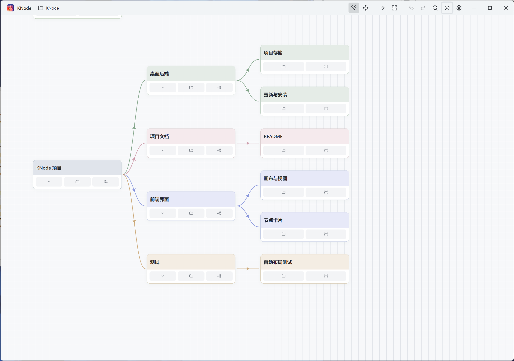
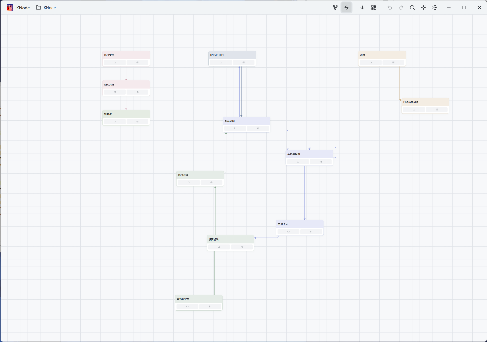

**简体中文** | [English](../en/README.md)

# KNode

KNode 是一款本地优先的 Windows 项目与知识整理工具。你可以用树视图拆解项目、归类资料，再切到图视图查看组件依赖、工作流程或知识关联。同一个节点可以在两种视图中使用。节点内部文件随项目保存在本地，关联的外部文件保留在原位置。

## 名称由来

KNode 结合了德语 **Knoten** 和英语 **Node**。两个词都可以指「节点」，也是 KNode 组织项目与资料的基本单位。

## 核心功能

- **树视图**　按父子层级组织任务、模块和文件分类，可折叠分支。带权重的子节点可汇总到父节点的进度。
- **图视图**　用单向、双向或无向连线描述功能关系、流程和知识关联，支持自环、循环关系，以及同一对节点之间的多条独立连线。
- **节点文件管理**　导入的内部文件存放在项目内的节点目录。关联本机已有的文件或文件夹时，项目只记录路径，原件留在原位置。
- **TXT 与 Markdown**　可为节点新建 `.txt` 或 `.md` 文件，记录说明、需求和笔记。
- **四向自动整理**　支持从左到右、从上到下、从右到左、从下到上的整理方向。树按父子层级排列。图中由至少三个节点组成、无分支、自环或平行边的独立简单链，沿选定方向排成一行或一列。其余关系（包括环状连接）使用基于 ELK Stress 的二维布局。

## 树视图与图视图

两种视图共享节点名称、颜色、进度和文件，分别保存各自的坐标与视口。树的父子层级和图的连线可以独立编辑。

### 树视图

适合把一个项目拆成模块、任务和子任务，或把资料按层级归类。



### 图视图

适合查看多个节点之间的依赖、流程与交叉关系。例如，同一组件可以同时连接多个模块。



## AI 辅助生成项目

把 [V3 数据格式说明](../../DATA_SCHEMA/zh-CN/V3.md) 和你的项目需求交给 AI，请它生成可直接打开的 KNode JSON。生成后，将纯 JSON 以 UTF-8 保存为 `学习计划/学习计划.json`，并将 JSON 内的 `name` 写为 `学习计划`。在 KNode 桌面端选择「打开项目」，打开这个 JSON。

可以从下面的提示词开始，把项目描述换成自己的内容：

```text
请根据我提供的《KNode V3 项目数据格式》生成一个「学习计划」项目。
按阅读、练习、复盘建立节点和子节点。
使用 format "forest-project"、version 3 和一个新的 UUID v4 作为 projectId。
根节点的 parentId 为 null，子节点引用真实存在的父节点，避免形成循环。
为每个节点提供 tree.positions 坐标，尽量错开卡片。保留两个视图的必填字段。
如果 graph.edges 包含连线，必须在 graph.positions 中为每条连线的 source 和 target 节点提供坐标。
如果没有图连线，graph.positions 可以写 {}，graph.edges 写 []。
请勿猜测本机文件路径。无外部文件关联时省略 linkedPaths。
只输出合法的 JSON，不附加 Markdown 围栏、注释或解释。
```

JSON 通过校验后，KNode 会为缺少图坐标的节点补位。图连线端点的坐标必须事先写入 `graph.positions`，才能通过校验。需要关联实际文件时，可以再通过节点的文件面板选择。

## 下载与安装

本页暂未提供下载链接。正式安装包提供后，Windows x64 用户可下载并运行 `-setup.exe`。桌面界面依赖 Microsoft Edge WebView2，安装包配置了 WebView2 下载引导。

## 技术栈

- **桌面端**　Tauri 2、Rust、Windows WebView2
- **界面与画布**　Vue 3、TypeScript、Vite、Vue Flow
- **自动布局**　树视图使用父子层级布局，图视图结合简单链排布与 ELK Stress

## MIT License

KNode 采用 [MIT 许可证](../../../LICENSE)。
